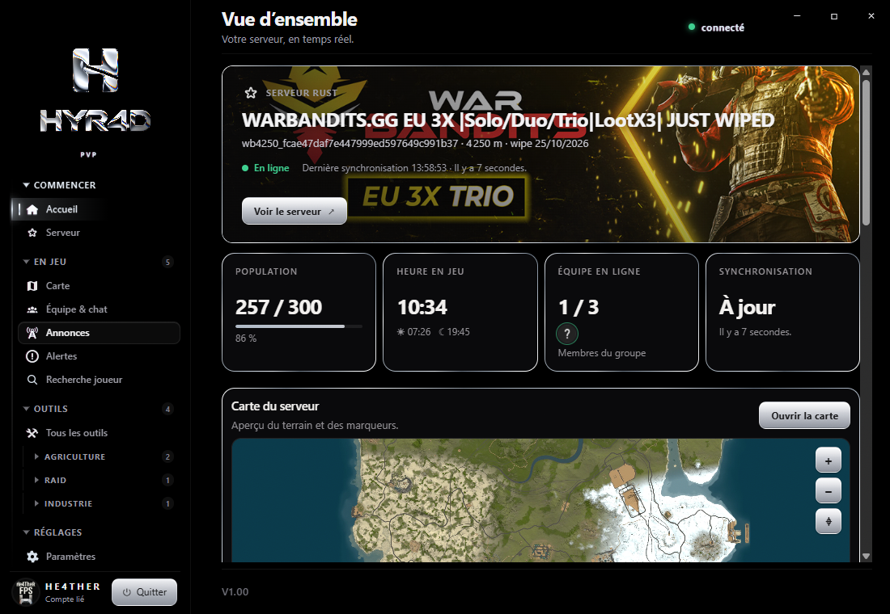
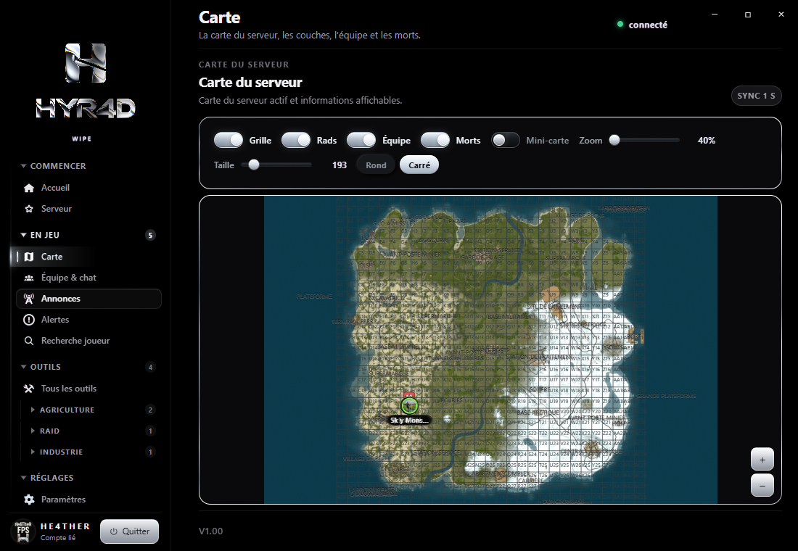
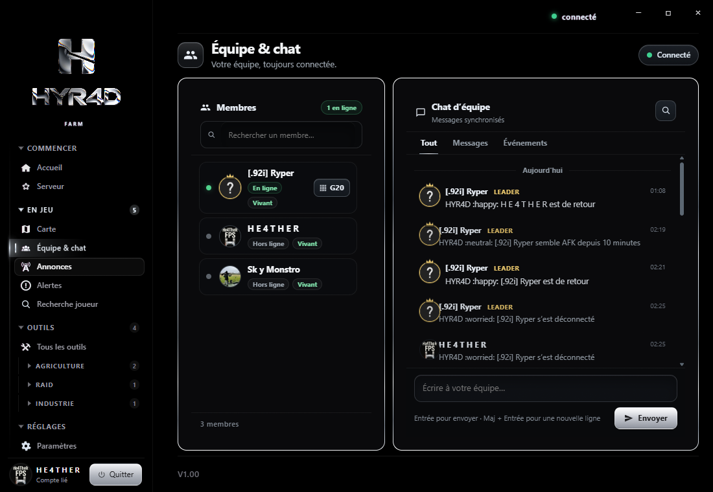
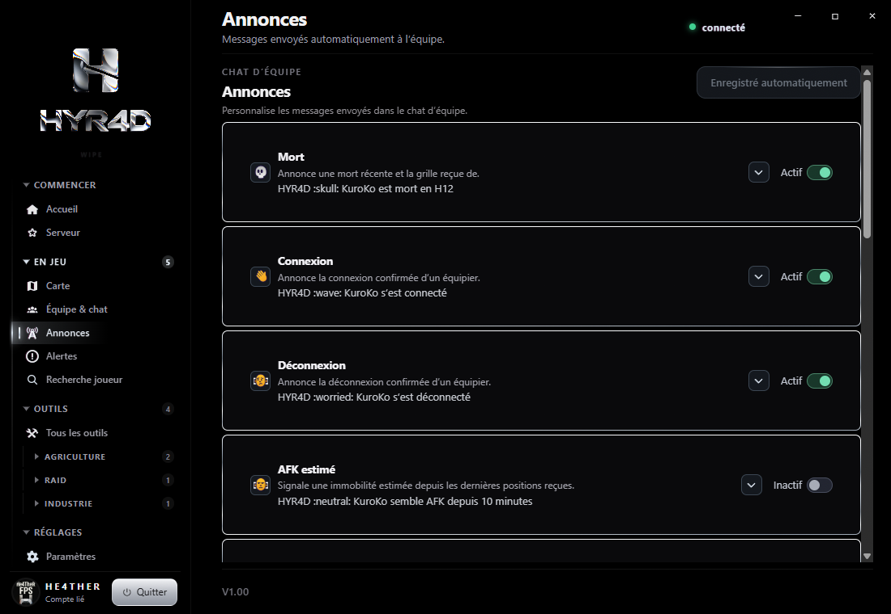
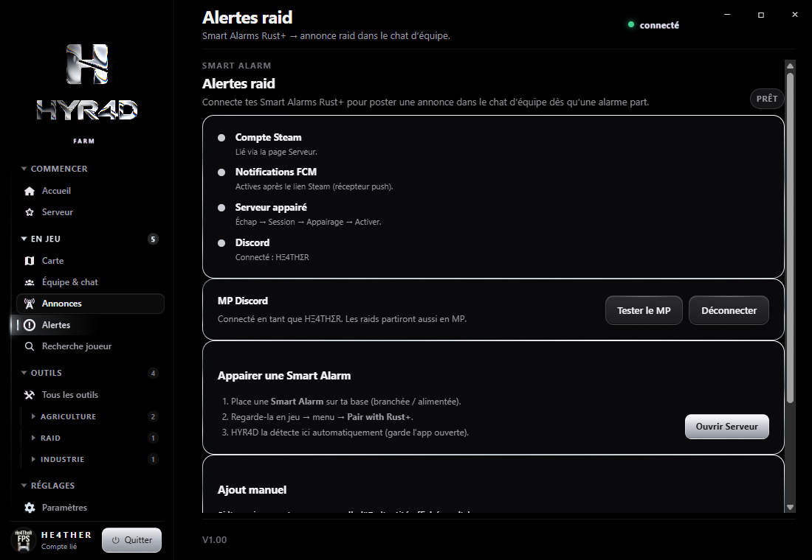

# HYR4D

Installateurs Windows publics de HYR4D.

  

  
  

  
  

Ce dépôt contient les installateurs, leurs signatures et les notes de version. Il ne contient pas le code source.

Une version n’est proposée aux applications déjà installées qu’après la publication manuelle d’une release stable.
